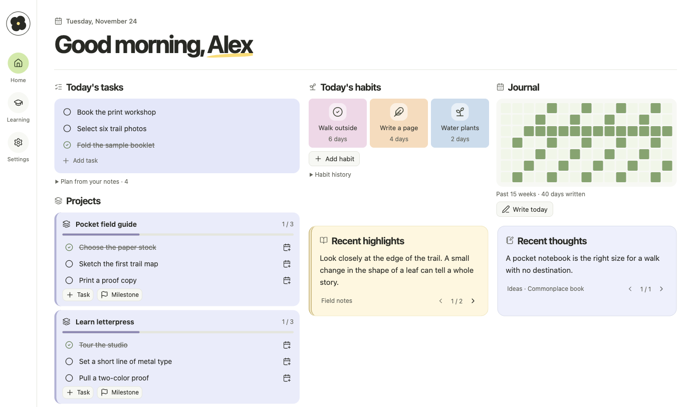

# Dora Dashboard

Plan today's work, check in on habits, and see when you last wrote in your journal. Dora Dashboard opens as a workspace tab in Obsidian. Its cards use your own Markdown files. A new vault starts with an empty dashboard.

[简体中文](README.zh-CN.md)

## Install and update

In **Settings → Community plugins → Browse**, search for **Dora Dashboard**, then install and enable it once the listing is available. Open the ribbon icon or run **Dora Dashboard: Open dashboard**. Use **Check for updates → Update** for later versions. While the listing is under review, the BRAT plugin can also install a beta from `zibochen6/dora-dashboard` using the same GitHub Release. The dashboard runs on desktop and includes English and Simplified Chinese.

## Your first day

1. Click **Write your first task**. It creates an ordinary Markdown checklist in your vault. Checking a task writes back to the source. **Undo last change** restores the checkbox.
2. Click **Link checklist** for an existing project, including a note at the vault root. Use the calendar next to an item to plan it for today. New projects can also contain milestones.
3. Add a habit and choose the days you want to track. Click a tile to check in or undo it. Open **Habit history** to see previous dates.
4. **Write today** opens today's journal. Select the vault folder and choose daily files (`YYYY-MM-DD.md`) or monthly files (`YYYY/YYYY-MM.md` with dated headings). The heatmap covers the last 15 weeks. Click a cell to open that day.

Opening the dashboard creates no content files. By default, the first save uses `Dora Dashboard/`. Choose a different destination in **Note sources**. Existing files stay at their current locations when you change that setting. Per-vault layout, bindings and switches live in Obsidian's plugin settings. Upgrading the plugin preserves both these settings and your notes.

## Make it yours

Both the sidebar gear and the plugin's settings tab open the same controls.

| Where                  | What you can change                                                                                                                                            |
| ---------------------- | -------------------------------------------------------------------------------------------------------------------------------------------------------------- |
| Appearance & layout    | Language, greeting name, startup behavior, card order and colors.                                                                                              |
| Pages & cards          | Turn each home card on or off. Enable Learning, Creator or Finances. Name custom pages and combine note links, today's tasks, milestones and project progress. |
| Note sources           | Choose an inbox, journal folder, books, thoughts, draft/idea folders or financial ledger. Link, rebind or unlink project checklists.                           |
| Accounts & connections | Set up optional creator sync, WeRead or a model for reflections.                                                                                               |

For highlights, select a note or folder with Markdown blockquotes (`> …`) or WeRead Markdown exports. For thoughts, select your own note or folder. Turn the cards on in **Pages & cards**. The arrows move between excerpts, long entries expand and the source title opens the original note. The **Learning** page shows the next unchecked task and milestones for projects marked **Learning**. The local **Finances** page records dated asset/liability snapshots, monthly income/expenses and a goal using a form.

## Optional connections and privacy

The core dashboard works offline. It has no telemetry, server, scheduled system task or external folder to install.

- **Creator sync.** Turn on the Creator page, then enable platform sync separately. Install [Ego Lite](https://lite.ego.app/download) yourself and sign in to the desired creator platforms in its browser. Click **Add creator account**, choose a platform and browser profile, verify the signed-in identity, then confirm the binding. Click **Sync works** to read published works, account metrics and follower observations from Douyin, Xiaohongshu, Kuaishou or Bilibili. Each account keeps a separate local archive. If the browser is missing or a login expires, your notes and the last completed archive remain available. Partial batches resume from a local checkpoint.
- **External browser access.** Creator sync invokes the installed `ego-browser` executable with the read-only platform adapters included in this release. This access outside the vault is needed for the browser the user authorized. Platform login sessions remain in Ego Lite. The plugin stores the chosen profile ID and creator account ID in vault-specific settings. It does not publish posts.
- **WeRead.** Local reading cards need no account. To fetch official highlights and comments, select your own [WeRead API key](https://weread.qq.com/r/weread-skills) in Obsidian's secret storage, test the connection, then sync under **Accounts & connections**. Requests go to `i.weread.qq.com`. Book notes and sync state stay in your selected dashboard folder. Each key has its own cache.
- **AI reflections.** Enter your own HTTPS Chat Completions endpoint and model, select a key in Obsidian's secret storage, and select which task, project or habit fields it may receive. You can inspect the destination and the complete request before enabling and before each generation. Journal text, financial records and creator analytics are outside the available fields. The configured provider may charge for requests. Reflections save to dated Markdown notes.

Creator identity, first works batches and follower reads have been tested on macOS (Apple Silicon) with Ego Lite. Xiaohongshu and Kuaishou detailed metrics were also sampled. Other desktop OS/browser combinations have not been verified. Platform dashboards can change; the plugin only replaces a confirmed archive after a complete successful run.

## Development

Use Node.js 24 and run `npm ci`, `npm test`, then `npm run build`. The three release assets are built in `dist/`. Run **Actions → Desktop tests → Run workflow** to test the published files and the community installer in Obsidian on a remote virtual display. These tests use temporary vaults and fictional data. For an interactive local run on macOS, explicitly allow test windows with `DORA_ALLOW_MAC_WINDOWS=1 npm run test:native`.

For a release, update `manifest.json`, the package version and `versions.json`, commit, then push the matching numeric Git tag (for example `1.0.1`). The release workflow runs tests and attaches `main.js`, `manifest.json` and `styles.css` individually. Users receive updates in Obsidian.

[MIT license](LICENSE) · [Third-party notices](THIRD-PARTY-NOTICES.md)
