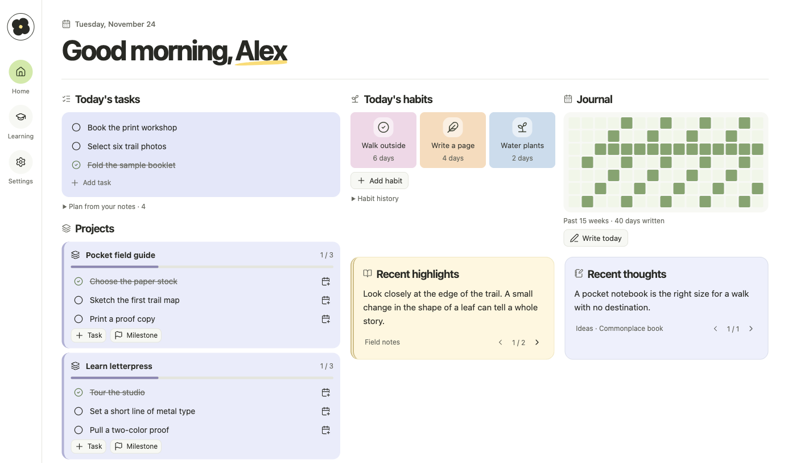

# Dora Dashboard 朵拉看板

在 Obsidian 的一个标签页里安排今天的事、查看项目、打卡和写日记。看板使用自己的 Markdown 笔记。新库从空白首页开始。

[English](README.md)

## 安装与更新

在 Obsidian 的 **设置 → 第三方插件 → 浏览** 搜索 **Dora Dashboard**，点「安装 → 启用」。从侧栏图标或命令面板打开看板。后续在第三方插件里点「检查更新 → 更新」即可。支持 Obsidian 桌面版 1.11.5 及以上，界面跟随 Obsidian，也可以手动选择中文或英文。[打开社区插件页](https://community.obsidian.md/plugins/dora-dashboard)

## 从第一张卡片开始

- **今日待办与项目。** 点「记第一条待办」，输入后按回车保存，Esc 取消。首页、项目、学习和自定义页都可以改名、勾选、安排到今天或撤销。点「新建项目」创建清单，也可用「关联已有清单」选择原笔记。在学习页创建的项目自动归入学习。
- **习惯与日记。** 新习惯只填名称即可每天打卡，也可选工作日或自定义日期。再点已打卡的习惯可撤回。日记只编辑当天正文，关闭后本次会话可以找回草稿。清空已有正文需单独确认。热力图支持用方向键选日期。
- **阅读与想法。** 在卡片或「笔记来源」选笔记或目录，绑定后即可看到内容。划线支持 Markdown 引用和微信读书摘录。长文可展开，多条可前后翻阅，点来源可打开原文。
- **学习、创作与财务。** 学习页显示下一步和里程碑。创作页可只管理本地稿件与选题。财务页直接切换账本币种，每个币种独立保留净资产目标。

首次打开时不会生成笔记。第一次保存才会按需写入 `Dora Dashboard/` 或你绑定的库内位置。更改默认目录后，旧文件仍保存在原位置。更新插件会保留笔记、绑定和布局。

## 一个设置页

| 位置       | 用途                                                                               |
| ---------- | ---------------------------------------------------------------------------------- |
| 外观与布局 | 修改昵称、语言、启动时打开、卡片顺序与配色。                                       |
| 栏目与卡片 | 隐藏单个卡片或整个栏目。可自建页面，组合笔记入口、待办、里程碑与项目进度。         |
| 笔记来源   | 选择默认目录、待办清单、日记及格式、摘录、财务、稿件和选题来源，管理已有项目清单。 |
| 账号与连接 | 单独启用自媒体同步、微信读书和 AI 寄语。                                           |

看板齿轮与 Obsidian 插件设置提供相同的配置。基础看板可离线使用，不收集遥测数据。

## 联网功能

- **创作平台。** 先开启自媒体栏目，再单独启用平台同步。自行安装 [Ego Lite](https://lite.ego.app/download)，在浏览器登录需要的平台。点「添加创作账号」，选择平台，有多个浏览器配置时再选配置，在同一窗口核对身份并确认绑定。点「同步作品」才开始读取。支持抖音、小红书、快手和 B 站，以及同平台多个账号。每个账号的作品、指标和粉丝记录分别保存在库内，中断后可续跑。上次完整结果会保留。
- **浏览器依赖。** 插件会调用库外已安装的 `ego-browser`，通过随插件发布的适配代码读取用户已登录的后台。平台登录态留在浏览器里，插件设置记录选择的浏览器配置 ID 和平台账号 ID。它不发布作品，不需要拷贝脚本或运行本地服务。已在 Apple Silicon Mac 实测四个平台的身份、首批作品与粉丝读取，以及小红书和快手的首批深度指标。其他桌面系统与浏览器组合尚未实测。
- **微信读书。** 本地书摘卡无需登录。直连时选择自己的[微信读书 API Key](https://weread.qq.com/r/weread-skills)，在 Obsidian 密钥库保存，测试连接后手动同步。请求发送到 `i.weread.qq.com`，书摘和评论在本地按密钥分别缓存。
- **AI 寄语。** 自己选 HTTPS 模型服务、模型名、语言和密钥，只勾选允许发送的待办、项目或习惯。开启前和每次生成前都可查看实际请求。日记正文、财务与平台数据不参与发送。模型服务可能按使用量收费，生成结果按日保存在库内。

开发使用 Node.js 24，依次运行 `npm ci`、`npm test`、`npm run build`。安装包的三个文件输出到 `dist/`。在仓库的 **Actions → Desktop tests → Run workflow** 可用远程虚拟桌面验证发布文件与社区安装流程。测试只使用临时库和虚构数据。在 macOS 上需要看本机测试窗口时，显式运行 `DORA_ALLOW_MAC_WINDOWS=1 npm run test:native`。

[MIT 许可证](LICENSE) · [第三方声明](THIRD-PARTY-NOTICES.md)
